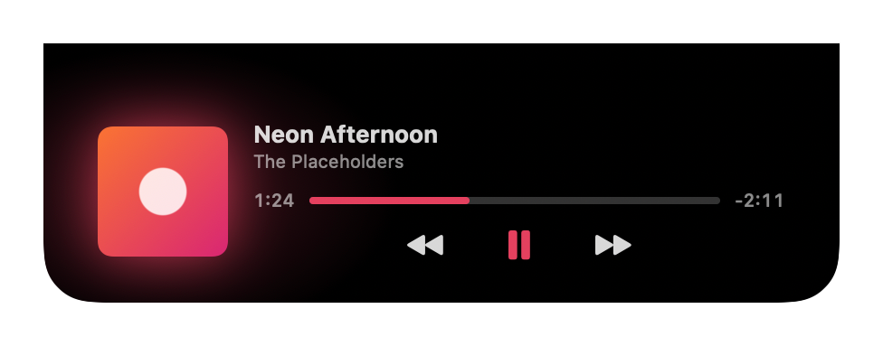

# Notch

A small macOS menu bar app that puts your next meeting and what's playing on Spotify into the MacBook notch.

<p align="center">
  
</p>
<p align="center">
  
</p>
<p align="center">
  
</p>
<p align="center">
  
</p>

<sub>Screenshots are rendered from the app's own views with made-up data.</sub>

## Features

### Meeting countdown

- Pops out of the notch **5 minutes before** a meeting (for 10 seconds), then again for the **final minute**, staying up until a minute after the start.
- A ring drains as the meeting gets closer. The countdown turns orange in the last minute and red in the last 10 seconds.
- **Join button** for Google Meet, Zoom and Microsoft Teams links, found in the event's URL, location or notes. It pulses as the meeting starts.
- **✕ hides only the reminder showing**: dismiss the 5-minute one and you still get the final-minute one.
- Skips meetings you've **declined**, all-day events and cancelled events.
- When two meetings overlap, the one that **hasn't started yet** wins.
- Tinted with the **calendar's colour**, so work and personal meetings look different.
- Choose which calendars to watch from the menu bar.

### Spotify card

- A small cover (or music note) sits beside the notch while Spotify plays. **Hover** to open the full card.
- Title and artist, with long titles **scrolling** instead of being cut off.
- **Play/pause, next and previous.**
- **Progress bar you can click or drag** to jump to any point in the song.
- Optional **album art** with a **glow** and accent colours taken from the cover.
- Smooth transitions between songs; the cover sits back slightly when paused.
- Hides itself after 2 minutes paused, and when Spotify quits.

### When nothing's happening

With no music playing and no meeting coming up, **hover the notch** to see:

- the **paused song**, with a play button to resume it;
- **today's meetings**: the one in progress (**Now**), the **Next** one with a countdown like "in 1h 20m", and up to three more, each with its calendar's colour and a **Join** button where there's a link;
- "No more meetings today" when your day is done.

To make this hoverable, the notch stays as a slightly wider black shape while idle.

### Battery

- **Plug in** and a green glow sweeps across the notch, then shows ⚡ and your battery level for 3 seconds.
- **Low battery**: the same sweep in red at **20%** and again at **10%**, while on battery.
- Each one shows once and then gets out of the way. It plays over the music card or a meeting reminder, which come back straight after.
- A loose cable that reconnects within a few seconds only plays it once.

### Without a notch

On a Mac or display without a notch there's no compact view, idle panel or battery flash. The music card shows briefly whenever a song starts, and meeting reminders work as normal.

## Requirements

- macOS 14 Sonoma or later. Made for MacBooks with a notch, but works on any Mac.
- The **Spotify desktop app**, for the music card.
- Only if you build it yourself: **Xcode 16 or later**. On recent macOS the command line tools alone aren't enough.

## Install

### Download

1. Get **Notch-x.y.z.zip** from the [latest release](https://github.com/abz2much/notch/releases/latest) and open it.
2. Drag **Notch.app** to your Applications folder, then open it.
3. macOS blocks it the first time, because the app isn't from the App Store or a paid Apple developer account. Go to **System Settings → Privacy & Security**, scroll down, click **Open Anyway** and confirm.

To update, quit Notch, replace the app in Applications and do step 3 again.

### Build it yourself

If you have Xcode, you can build it from source instead. It takes about a minute.

```sh
git clone https://github.com/abz2much/notch.git
cd notch
./build.sh
```

This builds `build/Notch.app`. Move it to Applications and open it:

```sh
mv build/Notch.app /Applications/
open /Applications/Notch.app
```

A calendar-with-clock icon appears in the menu bar. There's no Dock icon.

### Permissions

On first launch macOS asks for two permissions:

- **Calendars**: to read your events. Notch never creates, changes or deletes them.
- **Automation → Spotify**: to show the current track and control playback. Asked the first time Spotify is running.

If you said no by accident, the menu bar menu has a shortcut to the right System Settings page.

Because the app isn't signed with a paid Apple developer account, macOS may ask for these permissions again after you update or rebuild.

### Start at login

Add Notch in **System Settings → General → Login Items**.

## Using it

Click the menu bar icon to:

- choose which **calendars** to watch;
- turn the **music card** on or off;
- turn **album art** on or off;
- turn the **charging animation** and **low battery alert** on or off;
- quit.

## Privacy

- **Calendar access is read-only.**
- **Notch never launches Spotify** and only talks to it while it's already running.
- **Album art is off by default.** When on, Notch downloads each cover from Spotify's image server (`i.scdn.co`) only, with no cookies. Nothing else goes online.
- Song titles and artists are never written to logs.

## Development

```sh
swift build        # build
swift test         # run the tests
NOTCH_FAKE_SPOTIFY=1 build/Notch.app/Contents/MacOS/Notch   # fake playing track, no Spotify needed
NOTCH_FAKE_BATTERY=1 build/Notch.app/Contents/MacOS/Notch   # fake plug-in, then a drop to 20%
NOTCH_FAKE_SPOTIFY=1 NOTCH_SCREENSHOTS_DIR=docs/images swift test --filter Screenshots   # regenerate the README screenshots
```

### Releasing

On GitHub, open **Actions → Release → Run workflow**, pick `main` and type a version such as `1.2.0`. The workflow runs the tests, builds the app for Apple Silicon and Intel, tags the commit `v1.2.0` and publishes a release with the zip attached.


Built on [DynamicNotchKit](https://github.com/MrKai77/DynamicNotchKit).
