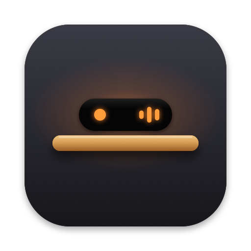
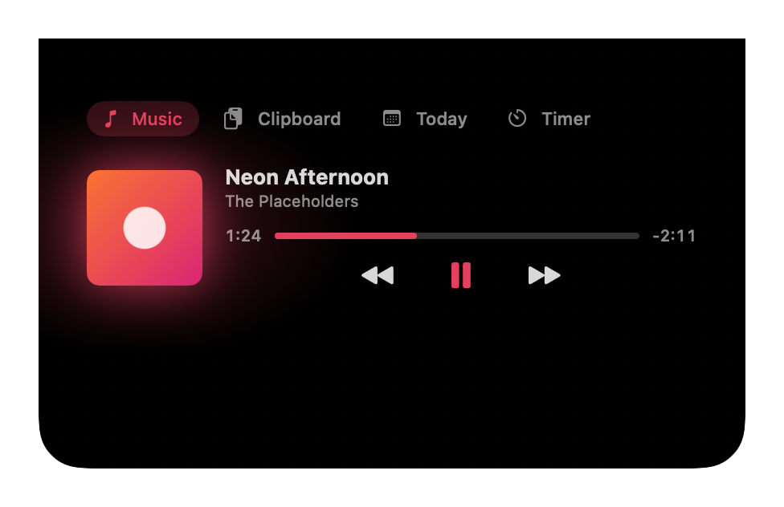
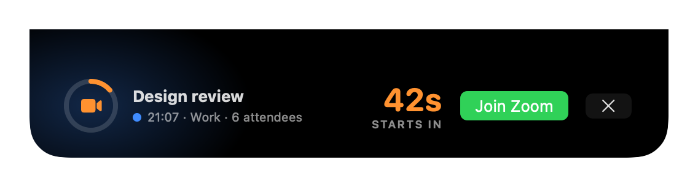
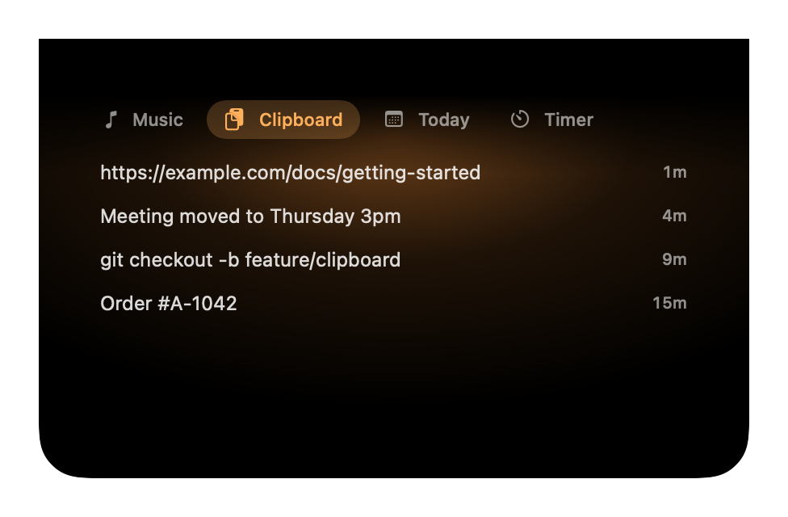
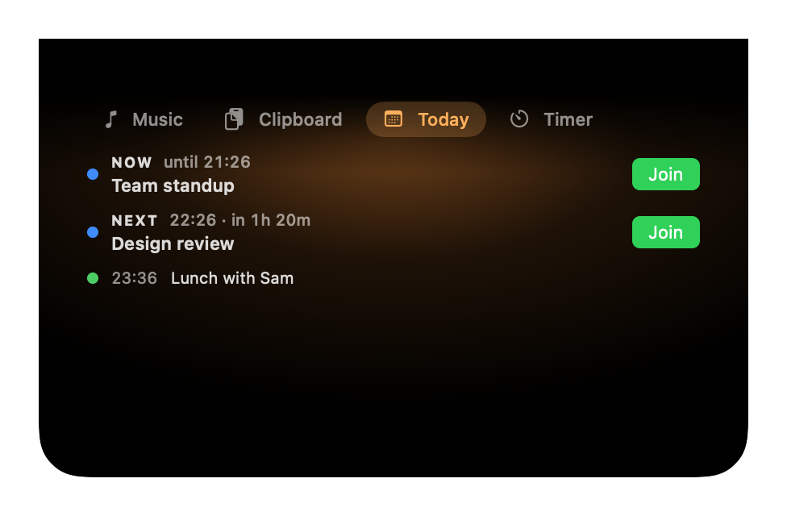
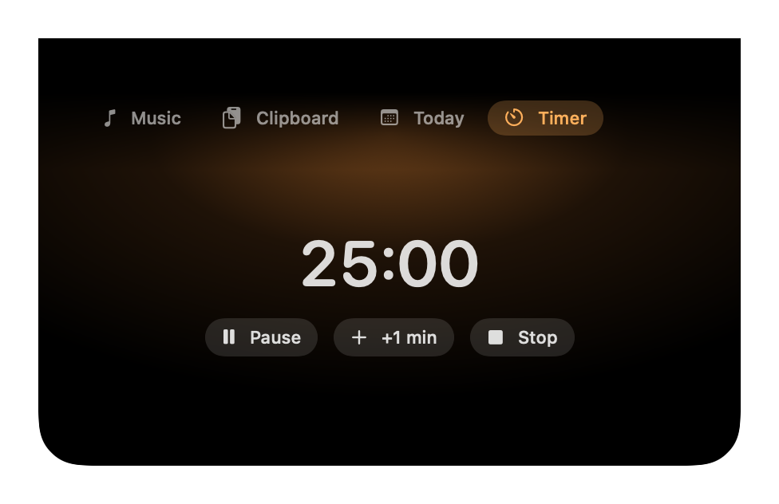

# Mantel

<p align="center"></p>

A small macOS menu bar app that keeps what you need at the top of your screen, in the MacBook notch: your next meeting, what's playing on Spotify or Apple Music, your recent copies, a timer and battery alerts. So you're on time and miss nothing.

<p align="center">
  
</p>
<p align="center">
  
</p>
<p align="center">
  
</p>
<p align="center">
  
</p>
<p align="center">
  
</p>
<p align="center">
  
</p>

<sub>Screenshots are rendered from the app's own views with made-up data.</sub>

## Features

### Meeting countdown

- Pops out of the notch **5 minutes before** a meeting (for 10 seconds), then again for the **final minute**, staying up until a minute after the start.
- A ring drains as the meeting gets closer. The countdown turns orange in the last minute and red in the last 10 seconds.
- **Join button** for Google Meet, Zoom and Microsoft Teams links, found in the event's URL, location or notes. It pulses as the meeting starts.
- **✕ hides only the reminder showing**: dismiss the 5-minute one and you still get the final-minute one.
- Skips meetings you've **declined**, all-day events and cancelled events.
- When two meetings overlap, the one that **hasn't started yet** wins.
- Tinted with the **calendar's colour**, so work and personal meetings look different.
- Choose which calendars to watch in Settings.

### Music card (Spotify and Apple Music)

- A small cover (or music note) sits beside the notch while Spotify or Apple Music plays. **Hover** and the panel opens on the Music tab.
- Title and artist, with long titles **scrolling** instead of being cut off.
- **Play/pause, next and previous.**
- **Progress bar you can click or drag** to jump to any point in the song.
- Live radio (such as Apple Music radio) shows **LIVE** instead, since there's no length to seek in. Radio often has no cover.
- Optional **album art** with a **glow** and accent colours taken from the cover.
- Smooth transitions between songs; the cover sits back slightly when paused.
- Hides itself after 2 minutes paused, and when the app quits.
- **Both apps open?** The card shows the one that's playing. If both are playing, the one that started last; if both are paused, the one you used last.

### Hover panel: Music, Clipboard, Today, Timer

**Hover the notch** to open a panel with four tabs. It opens on the tab you used last, and stays the same size on every tab.

- **Music**: the full music card, playing or paused, or "Nothing playing".
- **Clipboard**: your last 10 text copies, newest first. **Click one** to put it back on the clipboard, then press ⌘V where you want it.
  - Text only. Copying the same thing again moves it to the top.
  - Kept **in memory only**: nothing is saved, and the list is gone when Mantel quits.
  - Skips anything password managers mark as private, one-time codes and other temporary copies, and copied files.
  - Also skips copies from your iPhone (Universal Clipboard) and very large copies (over a million characters).
  - Turn it off, or clear it, in Settings.
- **Today**: the meeting in progress (**Now**), the **Next** one with a countdown like "in 1h 20m", and up to three more, each with its calendar's colour and a **Join** button where there's a link. "No more meetings today" when your day is done.
- **Timer**: start a **5, 15, 25 or 45-minute** timer. While it runs, the time left shows beside the notch, and the tab has **Pause**, **+1 min** and **Stop**.
  - When it ends, the notch drops down with **Time's up** and a chime for 10 seconds.
  - The 25-minute one is a **focus session**: when it ends, there's a button to start a **5-minute break**.
  - Meeting reminders and the charging flash still come first.

To make this hoverable, the notch stays as a slightly wider black shape while idle.

### Battery

- **Plug in** and a green glow sweeps across the notch, then shows ⚡ and your battery level for 3 seconds.
- **Low battery**: the same sweep in red at **20%** and again at **10%**, while on battery.
- Each one shows once and then gets out of the way. It plays over the music card or a meeting reminder, which come back straight after.
- A loose cable that reconnects within a few seconds only plays it once.

### Without a notch

On a Mac or display without a notch there's no compact view, hover panel (so no clipboard history) or battery flash. The music card shows briefly whenever a song starts, and meeting reminders work as normal.

## Requirements

- macOS 14 Sonoma or later. Made for MacBooks with a notch, but works on any Mac.
- The **Spotify desktop app** or **Apple Music**, for the music card.
- Only if you build it yourself: **Xcode 16 or later**. On recent macOS the command line tools alone aren't enough.

## Install

### Download

1. Get **Mantel-x.y.z.zip** from the [latest release](https://github.com/abz2much/notch/releases/latest) and open it.
2. Drag **Mantel.app** to your Applications folder, then open it.
3. macOS blocks it the first time, because the app isn't from the App Store or a paid Apple developer account. Within the hour, go to **System Settings → Privacy & Security**, scroll down, click **Open Anyway** and confirm.
4. Allow the permissions it asks for (see [Permissions](#permissions)).

If macOS says the app **is damaged and can't be opened**, run this in Terminal, then open it again:

```sh
xattr -dr com.apple.quarantine /Applications/Mantel.app
```

### Updates

Once installed in Applications, Mantel **updates itself**: it checks a minute after starting and every 6 hours, downloads a newer release, checks it's signed by Mantel's release certificate, swaps it in and reopens. There's no Open Anyway step, and macOS keeps Mantel's permissions.

- The repo is private, so updates download through the **GitHub CLI** (`gh`) with your own login. Install it with Homebrew (`brew install gh`) and run `gh auth login` once.
- Turn **Install Updates Automatically** off in Settings to only update when you choose **Check for Updates Now** in the menu.
- Updates only start from a release signed this way (1.3.0 or later). If you're on an older version, install the latest release by hand once, as above.

### Build it yourself

If you have Xcode, you can build it from source instead. It takes about a minute.

```sh
git clone https://github.com/abz2much/notch.git
cd notch
./build.sh
```

This builds `build/Mantel.app`. Move it to Applications and open it:

```sh
mv build/Mantel.app /Applications/
open /Applications/Mantel.app
```

Mantel's icon (the notch on a shelf) appears in the menu bar. There's no Dock icon.

### Permissions

macOS asks for these permissions, each the first time it's needed:

- **Calendars**: to read your events. Mantel never creates, changes or deletes them.
- **Automation → Spotify** and **Automation → Music**: to show the current track and control playback. Asked the first time each app is running.

If you said no by accident, the menu bar menu has a shortcut to the right System Settings page.

Updates keep these permissions. A copy you build yourself may ask again each time you rebuild.

### Start at login

Mantel adds itself to **System Settings → General → Login Items** the first time it opens from Applications, so it starts when you log in. Turn **Open at Login** off in Settings if you'd rather it didn't.

## Using it

Click the menu bar icon for:

- anything that needs your attention, such as calendar access being off, with a button to fix it;
- the version and update status, and **Check for Updates Now**;
- **Settings…** (or ⌘, while the menu is open), with three sections:
  - **General**: Open at Login, Install Updates Automatically;
  - **Features**: music card, album art, charging animation, low battery alert, clipboard history (and clearing it);
  - **Calendars**: which calendars to watch;
- quit.

## Privacy

- **Calendar access is read-only.**
- **Mantel never launches Spotify or Apple Music** and only talks to them while they're already running.
- **Album art is off by default.** When on, Mantel downloads Spotify covers from Spotify's image server (`i.scdn.co`) only, with no cookies. Apple Music covers are read from the Music app itself, with no download. Nothing else goes online.
- Song titles and artists are never written to logs.
- **Clipboard history stays in memory** and is never saved or logged. Private and temporary copies (passwords, one-time codes) are skipped.

## Development

```sh
swift build        # build
swift test         # run the tests
NOTCH_FAKE_SPOTIFY=1 build/Mantel.app/Contents/MacOS/Notch   # fake playing track, no Spotify needed
NOTCH_FAKE_BATTERY=1 build/Mantel.app/Contents/MacOS/Notch   # fake plug-in, then a drop to 20%
NOTCH_FAKE_SPOTIFY=1 NOTCH_SCREENSHOTS_DIR=docs/images swift test --filter Screenshots   # regenerate the README screenshots
```

### Releasing

On GitHub, open **Actions → Release → Run workflow**, pick `main` and type a version such as `1.2.0`. The workflow runs the tests, builds the app for Apple Silicon and Intel, signs it, tags the commit `v1.2.0` and publishes a release with `Mantel-X.zip` attached.

Releases are signed with a self-signed certificate kept in the repo secrets `NOTCH_SIGNING_P12` (the .p12 file, base64) and `NOTCH_SIGNING_PASSWORD`. Every release must use the same certificate (SHA-1 `19180d694e220d1d49ea3447a26528fcd16f1530`, which the workflow checks): installed copies only accept updates signed with it, and macOS ties Mantel's permissions to it. Local builds stay ad-hoc signed.

If a run fails while uploading, delete any leftover draft release on the Releases page before running it again.

Built on [DynamicNotchKit](https://github.com/MrKai77/DynamicNotchKit).
